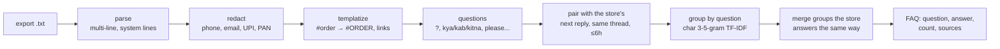

# chat2faq

A small shop's real FAQ isn't on its website. It's in its WhatsApp chats: the same twenty
questions asked hundreds of times, answered by whoever was holding the phone. chat2faq
reads WhatsApp exports and pulls out the questions customers actually ask and the answers
the store actually gives. Personal details are redacted, and every entry links back to the
chat lines it came from. The result is a starting knowledge base for a support bot, made
for a person to review, not to be shipped blind.


```bash
pip install git+https://github.com/yashere69/chat2faq
chat2faq exports/ --business "Your Store" -o faq.md --jsonl faq.jsonl
```

Export each customer chat from WhatsApp (chat → ⋮ → More → Export chat → Without media)
into one folder, the way they arrive: one `WhatsApp Chat with <name>.txt` per customer. A
single file works too.

What the parser handles, because real exports contain it:

- Android and iOS layouts, 12- and 24-hour clocks, the narrow no-break space newer Android
  builds put before "am", `a.m.`/`p.m.`, and the Hindi day periods (पूर्वाह्न/अपराह्न)
  a Hindi-language phone writes
- Dates with `/`, `.` or `-` between the parts, including year-first (`2026-01-11`)
- Invisible direction marks around phone-number senders (`+91 98765 43210` arrives
  wrapped in U+202A/U+202C), iOS's `~` before unsaved contacts, and the iOS habit of
  putting the contact's name on the encryption banner
- Files re-saved by Notepad or Excel: a byte-order mark, CRLF line ends, or UTF-16
- **Day/month order**, decided per file. Indian phones write 25/12/26, but a phone set to a
  US locale writes 12/25/26. Any first number above 12 means day first, any second number
  above 12 means month first. Use `--date-order` when a file has no evidence either way.
- Media and deletion placeholders (`<Media omitted>`, `image omitted`, `<attached: …>`,
  `This message was deleted`, missed calls, shared locations), which are skipped, not mined
  as text. The `<This message was edited>` marker is stripped, also from multi-line
  messages.
- The encryption notice and other system lines

Each of these has a fixture in [tests/fixtures](tests/fixtures), written to the format
and checked line by line in `tests/test_formats.py`. They are constructed, not real
exports. If your export parses wrongly, a redacted three-line sample is the most useful
bug report.

Devanagari is written in Roman letters before matching, so "मेरा ऑर्डर कब आएगा?" lands on
the same entry as "mera order kab tak aayega?".

[examples/faq.md](examples/faq.md) is the output for the sample folder in
[examples/exports](examples/exports). 21,000 lines of chat take about 2.5 seconds.

## Pipeline



Three steps carry most of the weight:

- **Character n-grams, not words.** Hinglish has no fixed spelling: "kab aayega", "kab
  ayega" and "kb aaega" share few words but most of their 3- to 5-letter fragments.
- **Merging on the answer.** "shipping charges?" and "delivery ka kitna lagega" share
  almost nothing, but the store sends the same reply to both. Customers' questions vary far
  more than the store's answers do, so a second pass merges any groups whose typical
  answers match. On the sample this takes 20 question groups down to 12 entries.
- **Lookup detection.** Order numbers and tracking links are replaced with `#[ORDER]` and
  `[LINK]` before grouping. Any entry whose answer still contains them is marked *needs a
  lookup*: "where is my order" can't be answered with fixed text, so a bot needs an
  order-status tool there. Knowing which FAQs need tools is half the design of a support
  agent.

## How well it works

`python tools/evaluate.py` runs three evaluations and writes
[results/evaluation.md](results/evaluation.md). All three use synthetic data, and the
section says where that flatters the numbers.

**On the sample.** The sample exports were generated with `nakli chats -n 40 --seed 7
--split` from [nakli](https://github.com/yashere69/nakli), which labels the intent of every
customer line with its file and line number. That makes the output scoreable (`--labels`):

| Data | Questions detected | Entry purity | Intents with an entry | Held-out covered |
|---|---|---|---|---|
| clean sample | 84.6% | 96.2% (12 entries) | 8/8 | 19/21 |
| messy copy | 74.8% | 95.7% (12 entries) | 8/8 | 17/19 |

The messy copy puts the same conversations through what real exports do to them (seed 11):
half go to the iOS format with direction marks, some customers become bare phone numbers,
some files get a BOM and CRLF, 40% of customer messages lose their "?", 15% get a typo, 20%
get an emoji, and media, deleted and "ok" lines appear between messages. Parsing survives
all of it. Question detection drops by ten points, mostly from the missing question marks.

Purity measures whether an entry's questions share an intent. Two mistakes are visible in
the sample output. "delivery charge kitna hai" lands in the size-chart entry, because
"kitna hai" also appears in "XL ka bust kitna hai?". COD gets two entries, because the store
answered in two different wordings and the answer merge only joins near-identical replies.

**On questions it wasn't built from.** Purity on template-generated chats flatters any
method, so [examples/probe.jsonl](examples/probe.jsonl) has 48 questions written separately
from nakli's templates, six per intent. They use other words, English-only and Devanagari
phrasings, and one with an order number. `--probe` asks the FAQ built from the sample to
answer each one:

| Similarity threshold | Right entry | Wrong entry | No entry |
|---|---|---|---|
| 0.20 | 27 | 9 | 12 |
| 0.25 | 23 | 3 | 22 |
| **0.30 (default)** | **19** | **3** | **26** |
| 0.35 | 16 | 1 | 31 |

So at the default, it answers 40% of new phrasings correctly and rarely answers wrongly.
Most misses are synonyms that character n-grams can't connect: "paisa kab wapas aayega" for
refund, "kapda rang chhodega" for colour bleed. Romanizing Devanagari moved 2 of the 8
Devanagari probes from no answer to the right entry, and 1 to a wrong one. The probe
questions were written by the author of this tool, so treat them as a check, not a
benchmark.

That is the reason the output is a draft for a person and a knowledge base for an LLM bot,
not an intent classifier. Run `--probe` with questions your own customers ask to see where
your FAQ stands.

## Privacy

- With [parda](https://github.com/yashere69/parda) installed (`pip install git+https://github.com/yashere69/parda`), its
  check-digit and Devanagari-aware detectors are used. Otherwise built-in patterns cover
  phone, email, UPI and PAN. The CLI prints which backend ran.
- Redaction happens before grouping, so personal details never reach the FAQ, the JSONL or
  the console.
- Customer names stay out too. Replies are de-personalised ("Namaste Asha!" → "Namaste!")
  before an answer is chosen, but source references keep file and line numbers so you can
  check them.
- Your customers didn't write those messages expecting them to train a bot. Use this on your
  own business's chats, and keep the output internal unless you've told customers.

## Choices

- **Own parser, not whatstk.** [whatstk](https://github.com/lucasrodes/whatstk) is a mature
  WhatsApp parser with chat analytics, but it's GPL-3.0 and pulls in pandas and plotly.
  The parser here is about 150 lines and keeps the package MIT and dependency-free.
- **No embeddings, no LLM.** Grouping is pure Python and deterministic, so the same export
  always produces the same FAQ. An embedding model should group paraphrases better, but the
  one offline embedder I could test didn't: with WordLlama (static, English-trained) the
  closest entry was right for 24 of the 48 probe questions, against 34 for n-grams, and
  averaging the two only moved along the same right/wrong trade-off as lowering the
  n-gram threshold (`tools/probe_wordllama.py`). A multilingual model that knows "paisa
  wapas" means refund is the backend worth adding; it hasn't been measured here.
- **Single-pass grouping.** It's order-dependent but linear-ish and needs no numpy. With
  tens of thousands of questions, swap it for proper agglomerative clustering.

## Limits

- Pairing takes the store's next message to that customer within six hours. If the store
  answers two questions in one message, both get the same answer.
- Media, voice notes, deleted messages and replies-to-quote aren't interpreted.
- Group chats work, but every non-store sender is treated as a customer, and a group
  system notice that happens to contain ": " would be read as a message.
- Matching is character n-grams, so synonyms and translations are invisible to it: "paisa"
  doesn't meet "refund", and "रंग" only meets "rang", not "colour".

Stable: the CLI, the markdown and JSONL output, and the label format. Experimental: the
grouping thresholds and the romanization rules.

## Development

```bash
pip install -e ".[dev]"
ruff check . && ruff format --check . && mypy src && pytest
python tools/evaluate.py    # regenerates results/evaluation.md; rerun after any grouping change
```

A parser fix should come with a fixture in `tests/fixtures`, a few lines in the exact
format, with personal details replaced. A change to grouping or thresholds should show its
effect on `results/evaluation.md` in the same commit, the probe rows included.

MIT licensed.
