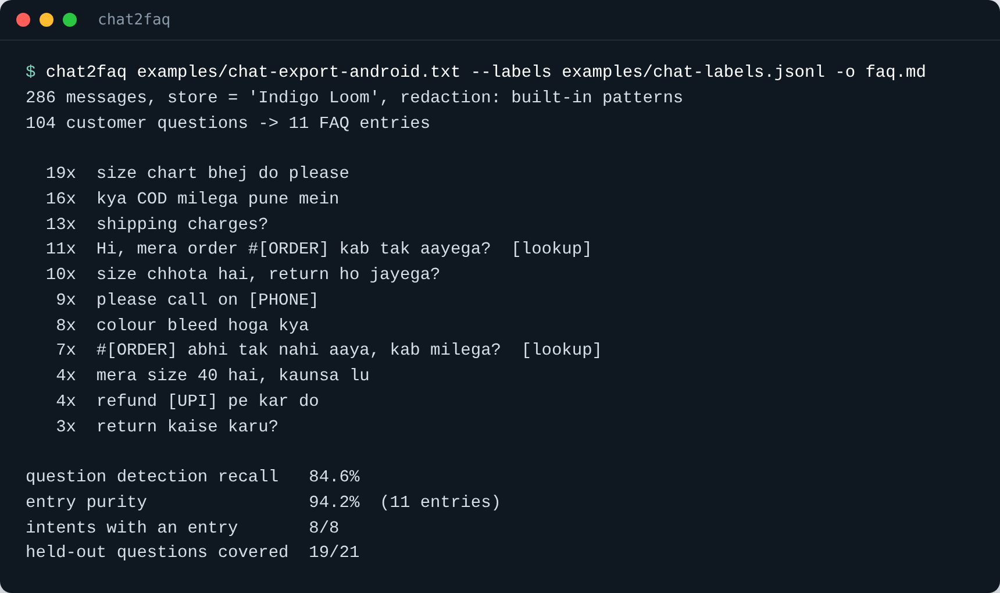
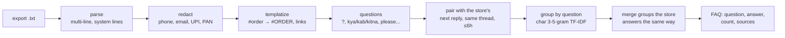

# chat2faq

A small shop's real FAQ isn't on its website. It's in its WhatsApp chats: the same twenty
questions asked hundreds of times, answered by whoever was holding the phone. chat2faq
reads WhatsApp exports and pulls out the questions customers actually ask and the answers
the store actually gives. Personal details are redacted, and every entry links back to the
chat lines it came from. The result is a starting knowledge base for a support bot, made
for a person to review, not to be shipped blind.



```bash
pip install git+https://github.com/yashere69/chat2faq
chat2faq "WhatsApp Chat with Asha.txt" -o faq.md          # one export
chat2faq exports/ --business "Your Store" -o faq.md --jsonl faq.jsonl
```

Export a chat from WhatsApp (chat → ⋮ → More → Export chat → Without media), or export
several into one folder. Android and iOS formats both work, with 12- or 24-hour clocks.
[examples/faq.md](examples/faq.md) is the output for the sample export.

## Pipeline



Three steps carry most of the weight:

- **Character n-grams, not words.** Hinglish has no fixed spelling: "kab aayega", "kab
  ayega" and "kb aaega" share few words but most of their 3- to 5-letter fragments.
- **Merging on the answer.** "shipping charges?" and "delivery ka kitna lagega" share
  almost nothing, but the store sends the same reply to both. Customers' questions vary far
  more than the store's answers do, so a second pass merges any groups whose typical
  answers match. On the sample this takes 20 question groups down to 11 entries.
- **Lookup detection.** Order numbers and tracking links are replaced with `#[ORDER]` and
  `[LINK]` before grouping. Any entry whose answer still contains them is marked *needs a
  lookup*: "where is my order" can't be answered with fixed text, so a bot needs an
  order-status tool there. Knowing which FAQs need tools is half the design of a support
  agent.

## How well it works on the sample

The sample export was generated with [nakli](https://github.com/yashere69/nakli), which
labels the intent of every customer line. That makes the output scoreable (`--labels`):

| Measure | Result |
|---|---|
| Customer messages detected as questions | 84.6% |
| Entry purity (questions in an entry sharing its main intent) | 94.2% |
| Intents that got an entry | 8 / 8 |
| Held-out questions (last 20% by time) matched to the right entry | 19 / 21 |

A visible mistake is left in on purpose: "delivery charge kitna hai" lands in the
size-chart entry, because "kitna hai" also appears in "XL ka bust kitna hai?". Character
n-grams are good with spelling variation and bad with short shared phrases. The 15% of
messages missed as questions are mostly requests without a question word ("refund is UPI pe
kar do").

nakli's chats are template-generated and far tidier than real ones, so expect lower numbers
on a real export. Real chats need a hand-labelled sample to measure against; the evaluation
code doesn't change.

## Privacy

- With [parda](https://github.com/yashere69/parda) installed (`pip install git+https://github.com/yashere69/parda`), its
  check-digit and Devanagari-aware detectors are used. Otherwise built-in patterns cover
  phone, email, UPI and PAN. The CLI prints which backend ran.
- Redaction happens before grouping, so personal details never reach the FAQ, the JSONL or
  the console.
- Customer names stay out too. Replies are de-personalised ("Namaste Asha!" → "Namaste!")
  before an answer is chosen, but source references keep file and line numbers so you can
  check them.
- Your customers didn't write those messages expecting them to train a bot. Use this on your
  own business's chats, and keep the output internal unless you've told customers.

## Choices

- **Own parser, not whatstk.** [whatstk](https://github.com/lucasrodes/whatstk) is a mature
  WhatsApp parser, but it's GPL-3.0 and pulls in pandas and plotly. Parsing two export
  formats takes about 70 lines here and keeps the package MIT and dependency-free.
- **No embeddings, no LLM.** Grouping is pure Python and deterministic, so the same export
  always produces the same FAQ. An embedding model would group paraphrases better; a next
  version could take one as an optional backend and keep this as the baseline it has to beat.
- **Single-pass grouping.** It's order-dependent but linear-ish and needs no numpy. With
  tens of thousands of questions, swap it for proper agglomerative clustering.

## Limits

- Pairing takes the store's next message to that customer within six hours. If the store
  answers two questions in one message, both get the same answer.
- Media, voice notes, deleted messages and replies-to-quote aren't interpreted.
- Group chats work, but every non-store sender is treated as a customer.

MIT licensed.
